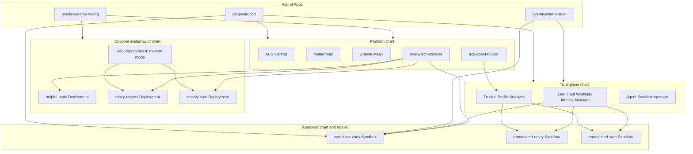

# AI Security Overwatch

**ACS AI Overwatch** is a security demonstration on OpenShift. Red Hat Advanced Cluster Security (ACS / RHACS) finds shadow AI agents, and an in-cluster rebuild replaces a caught agent with an approved Agent Sandbox.

Shadow Agentic IT is shadow IT applied to agents. Teams stand up unsanctioned chatbots and tool-using pods, often with an unapproved model, no telemetry, and extra capabilities such as scanners or a missing required label. This repository shows the loop from detection through replacement.

| Stage | What happens |
| --- | --- |
| Optional wrong phase | Helpful Hank, Rosey Regrets, and Sneaky Sam run as plain pods. ACS is in monitor mode, so the violations are recorded and the pods stay up. Skip this Application for an actual deployment. |
| Trust plane | Trusted Profile Analyzer, Zero Trust Workload Identity Manager (SPIFFE/SPIRE), and the Red Hat build of Agent Sandbox are installed before any rebuild. Kata stays off unless you opt in. |
| Identify, terminate, rebuild | ACS switches to enforce, the shadow pods are removed, and the builder publishes a remediated image only after Trusted Profile Analyzer accepts the SBOM. |
| Approved agents | OpenClaw inside NVIDIA OpenShell, scheduled as an Agent Sandbox, with a SPIFFE JWT-SVID and Granite through Models-as-a-Service. Compliant Chris is the greenfield control. |

The platform under that story:

- Red Hat OpenShift 4.20–4.22 and OpenShift AI 3.5 (`stable-3.5`), with OGX. OpenShift 4.19.9 and later can run OpenShift AI 3.5 if the operator channel matches the cluster.
- RHACS runtime and deploy-time `SecurityPolicy` custom resources.
- UBI and llama.cpp for the optional misbehavior agents.
- Mattermost as the Slack-compatible sink for ACS violations.
- OpenShift internal registry ImageStreams for agent images. On-cluster Quay is optional and stores blobs in SeaweedFS.
- Red Hat Trusted Profile Analyzer 3.x (`rhtpa-operator` channel `stable-v3`) as the SBOM system of record.
- Zero Trust Workload Identity Manager for SPIFFE/SPIRE. Approved pods receive a JWT-SVID through the supported SPIFFE Helper, not a Python SPIFFE client.
- Red Hat build of Agent Sandbox as the workload API. OpenShift sandboxed containers (Kata) are optional.
- NVIDIA OpenShell as the application sandbox, with OpenClaw as the harness.

Deploy with OpenShift GitOps (Argo CD). The Applications are listed in [What each Application installs](#what-each-application-installs).

Wrong agents are plain Deployments. Approved agents are OpenClaw inside OpenShell on an Agent Sandbox. The investigator and the builder use OpenShift AI 3.5 (`LLMInferenceService`). The builder does not publish a remediated image until Trusted Profile Analyzer has the SBOM and the package list is clean.

## Table of contents

1. [Quick start](#quick-start)
2. [Solution overview](#solution-overview)
3. [Architecture](#architecture)
4. [Repository layout](#repository-layout)
5. [Prerequisites](#prerequisites)
6. [Before Argo CD](#before-argo-cd)
7. [What each Application installs](#what-each-application-installs)
8. [Cluster settings](#cluster-settings)
9. [Storage and Quay](#storage-and-quay)
10. [OpenShift AI, GPUs, and certificates](#openshift-ai-gpus-and-certificates)
11. [Agent images](#agent-images)
12. [Agents](#agents)
13. [Trusted Profile Analyzer](#trusted-profile-analyzer)
14. [ACS and Mattermost](#acs-and-mattermost)
15. [Demo walkthrough](#demo-walkthrough)
16. [Troubleshooting](#troubleshooting)
17. [Local validation](#local-validation)

## Quick start

Do the shared setup once, then follow one path. Path A and the misbehavior Application both want to own the same `SecurityPolicy` names. Delete `acs-ai-overwatch-misbehavior` before converting a demo cluster into Path A.

**Shared setup**

```bash
oc login
./scripts/check-prereqs.sh
./scripts/cluster-admin/install-pre-gitops.sh
./scripts/cluster-admin/05-apply-platform-prep.sh
oc get storageclass    # values.yaml expects gp3-csi
```

On a fork, set `spec.source.repoURL` in every `gitops/argocd/application*.yaml`. Those paths are symlinks into `gitops/argocd/overlays/`.

Regenerate `gitops/helm/acs-ai-overwatch/values-cluster.yaml` for this cluster and commit it when Argo CD should use those hostnames. A file left over from another sandbox publishes Routes on a DNS name that no longer exists. See [Cluster settings](#cluster-settings).

**Path A — actual deployment.** Platform, observability, trust plane, and Compliant Chris. Hank, Rosey, and Sam are never created.

```bash
oc apply -k gitops/argocd/
```

**Path B — live demo.** Start with the shadow agents in monitor mode. After the violations are visible, install the trust plane and rebuild.

```bash
oc apply -k gitops/argocd/overlays/demo-wrong
# after Mattermost shows the violations:
oc apply -k gitops/argocd/overlays/demo-trust
./scripts/demo/identify-terminate-rebuild.sh
```

**Then, on either path**

```bash
oc get cm -n acs-ai-overwatch-system acs-ai-overwatch-cluster-config
oc annotate application acs-ai-overwatch -n openshift-gitops \
  argocd.argoproj.io/refresh=hard --overwrite
```

Wait until `oc get application -n openshift-gitops` shows the `acs-ai-overwatch*` apps `Synced`. The trust-plane app stays `Progressing` until Keycloak, TPA, and the SPIRE operands are ready.

BuildConfigs in `acs-agent-builder` use a `ConfigChange` trigger. OpenShift starts a build when the BuildConfig is **created**. That trigger does not fire again when the BuildConfig is only updated, and it does not fire for BuildConfigs that already exist from an older chart revision. After the first successful create, confirm ImageStream tags:

```bash
oc get imagestream -n acs-agent-builder
oc get builds -n acs-agent-builder
```

Rebuild from the working tree, without waiting for a git push, from the repository root:

```bash
oc start-build acs-investigator --from-dir=. --follow -n acs-agent-builder
oc start-build acs-agent-builder --from-dir=. --follow -n acs-agent-builder
oc start-build overwatch-console --from-dir=. --follow -n acs-agent-builder
oc start-build compliant-chris --from-dir=. --follow -n acs-agent-builder
oc start-build remediated-rosey --from-dir=. --follow -n acs-agent-builder
oc start-build remediated-sam --from-dir=. --follow -n acs-agent-builder
# Path B only:
oc start-build helpful-hank --from-dir=. --follow -n acs-agent-builder
oc start-build rosey-regrets --from-dir=. --follow -n acs-agent-builder
oc start-build sneaky-sam --from-dir=. --follow -n acs-agent-builder
```

A missing `:latest` tag surfaces as `ErrImagePull` / `manifest unknown` on the agent pod. That is an empty ImageStream, not an authentication failure.

`values-poc.yaml` turns on RHACS Central, the investigator, MaaS, the builder, Quay, Pipelines, and the console. It turns the three shadow agents off; those come from the misbehavior chart. Login and the ACS notifier are in [ACS and Mattermost](#acs-and-mattermost). The presenter script is [Demo walkthrough](#demo-walkthrough).

```bash
export OVERWATCH_URL="https://$(oc get route overwatch-console -n test-range -o jsonpath='{.spec.host}')"
```

**OpenShift AI.** This PoC targets OpenShift AI 3.5 (`stable-3.5`) on OpenShift 4.20–4.22. Discovery selects `stable-3.5`, `fast-3.5`, or `eus-3.5` from the catalog (`RHOAI_TARGET_VERSION`, default `3.5`).

**User Workload Monitoring** is a MaaS prerequisite. `check-prereqs.sh` warns when it is off. The observability chart also enables it. To set it yourself:

```bash
oc get configmap cluster-monitoring-config -n openshift-monitoring || \
  oc create configmap cluster-monitoring-config -n openshift-monitoring \
    --from-literal=config.yaml=$'enableUserWorkload: true\n'
```

**Kueue is not required.** The DataScienceCluster keeps `kueue.managementState: Removed`. Install the Kueue operator only if you later change that field. OpenShift AI 3.5 rejects `Managed` for Kueue.

**cert-manager.** The cert-manager Operator for Red Hat OpenShift is already installed on the target cluster. The chart creates Certificate custom resources and does not add a second Subscription or OperatorGroup. A second OperatorGroup fails the CSV with `TooManyOperatorGroups`.

**Service Mesh 3** is an OGX prerequisite. `05-apply-platform-prep.sh` subscribes to it, and the Helm chart does too. Product MaaS (`aigateway`) stays `Removed`. The demo front door is the API proxy in `acs-maas`.

**Model Catalog.** Investigator Gemma and MaaS Granite are `LLMInferenceService` custom resources. `spec.model.uri` is the catalog ModelCar image:

- `oci://registry.redhat.io/rhelai1/modelcar-gemma-2-9b-it-fp8:1.5`
- `oci://registry.redhat.io/rhelai1/modelcar-granite-3-1-8b-instruct-fp8-dynamic:1.5`

OpenShift pulls them with the cluster pull secret, the same path as **AI hub → Models Catalog**. Rogue MiniCPM GGUF still comes from Hugging Face inside the agent pod.

## Solution overview

This PoC demonstrates shadow Agentic IT. ACS tracks unsanctioned agents. The builder turns a caught agent into an approved Agent Sandbox after Trusted Profile Analyzer accepts the image.

### Wrong and right

| Workload | Behavior | What RHACS sees in the wrong phase |
| --- | --- | --- |
| Helpful Hank | Local unaudited MiniCPM GGUF on a plain pod | Telemetry label present; no recon processes |
| Rosey Regrets | Same GGUF plus nmap, masscan, rustscan, and naabu | Runtime policy `test-range-runtime-guardrails` (monitor) |
| Sneaky Sam | Same GGUF, omits the telemetry label | Deploy policy `test-range-sneaky-sam-telemetry-violation` (monitor) |
| Remediated Rosey / Sam | OpenClaw inside OpenShell on an Agent Sandbox, TPA-cleared, SPIFFE JWT-SVID, MaaS Granite | Created only after enforce and rebuild |
| Compliant Chris | Same approved shape from day one, plus the placement CSV UI | Deployed by the approved Application |

During the optional phase, ACS monitor mode leaves those pods running. `scripts/demo/identify-terminate-rebuild.sh` switches the misbehavior policies to enforce (`KILL_POD_ENFORCEMENT` / `SCALE_TO_ZERO_ENFORCEMENT` and admission fail) only after the trust plane is up. An actual deployment never installs the misbehavior Application. The approved chart syncs the enforce-mode policies itself.

### What the platform provisions

1. OpenShift AI 3.5 on one AWS `g6.12xlarge` (4× NVIDIA L4 on a single node).
2. Time-sliced L4s (`nvidia.com/gpu`) for Hank, Rosey, Sam, and the agentic builder. Compliant Chris is CPU-only OpenShell and talks to MaaS.
3. Gemma 2 9B Instruct FP8 (Model Catalog ModelCar) for the ACS investigator.
4. Granite 3.1 8B Instruct FP8 (Model Catalog ModelCar) for the demo MaaS proxy.
5. RHACS runtime and deploy `SecurityPolicy` custom resources scoped to `test-range`.
6. Mattermost and a webhook bridge that also fans out to the investigator.
7. BuildConfigs that produce every agent image, including Remediated Rosey and Sam.

**Demo loop**

```
oc apply -k gitops/argocd/overlays/demo-wrong
        │
        ▼
Rosey (plain pod, llama.cpp) tool-calls nmap, masscan, rustscan, naabu
Sam is deployed without the telemetry label
ACS monitor mode records both and leaves the pods running
        │
        ▼
oc apply -k gitops/argocd/overlays/demo-trust
        │
        ▼
Trust plane: TPA (Keycloak + Postgres + SeaweedFS), ZTWIM (SPIRE),
Agent Sandbox operator. Kata stays off unless enable-kata.sh ran.
        │
        ▼
./scripts/demo/identify-terminate-rebuild.sh
ACS enforce removes the shadow pods. The builder scans the new image,
uploads the SBOM to TPA, and applies Sandbox CRs.
```

## Architecture

### GPU map

Use one `g6.12xlarge` (4× NVIDIA L4, 24 GB each). Three `g6.4xlarge` nodes give one L4 each and are the wrong shape for this demo.

GPU Operator 26.3 time-slicing is per node. The device plugin ignores a per-GPU `devices` list and `rename`. `05-apply-platform-prep.sh` labels the NVIDIA node `nvidia.com/device-plugin.config=shared`. That config keeps `renameByDefault: false` and replicates `nvidia.com/gpu` on every L4 (4 GPUs × 4 replicas = 16 slots). Agents, the builder, Gemma, and Granite each request `nvidia.com/gpu: 1`.

NVIDIA time-slicing does not isolate VRAM. vLLM is set to `gpuMemoryUtilization: 0.75` so one MiniCPM sidecar can share a 24 GB L4 with Gemma or Granite. Two vLLM pods on the same physical L4 still run out of memory. The device plugin normally spreads the first four GPU pods across the four L4s.

| Slots | Resource | Workloads |
| --- | --- | --- |
| 16 | `nvidia.com/gpu: "1"` | Hank, Rosey, Sam, builder, Gemma, Granite |

### Platform diagram



Apply one kustomization at a time. `gitops/argocd` is Path A. `overlays/demo-wrong` is the shadow phase. `overlays/demo-trust` adds the trust plane and Compliant Chris onto a cluster that already has the platform.

### Namespaces

| Namespace | Role |
| --- | --- |
| `test-range` | Optional shadow Deployments, then approved Agent Sandboxes |
| `acs-investigator` | Gemma investigator |
| `acs-agent-builder` | Agentic builder, BuildConfigs, and ImageStreams |
| `acs-maas` | Granite MaaS gateway |
| `monitoring` | Mattermost and the ACS webhook bridge |
| `quay` | Optional on-cluster registry and its SeaweedFS S3 store |
| `stackrox` | ACS Central |
| `trusted-profile-analyzer` | TPA operator, TPA Postgres, and the SBOM S3 store |
| `keycloak` | Red Hat build of Keycloak for the TPA realm |
| `zero-trust-workload-identity-manager` | ZTWIM and SPIRE |
| `agent-sandbox-system` | Agent Sandbox operator |
| `openshift-sandboxed-containers-operator` | Kata, only after `enable-kata.sh` |
| `acs-ai-overwatch-system` | Cluster discovery ConfigMap |
| `acs-ai-overwatch-observability` | OTEL collector, Tempo, MLflow, Grafana |

NetworkPolicies keep the shadow Deployments off MaaS. Approved Sandboxes (`acs-ai-overwatch.io/approved=true`) and the investigator can reach the gateway. ZTWIM issues a SPIFFE ID only to pods in `test-range` with that label.

## Repository layout

```
acs-ai-overwatch/
├── README.md
├── Makefile
├── agents/
│   ├── common/acs_agent/              # FastAPI harness, investigator, builder
│   ├── helpful-hank/                  # UBI + MiniCPM sidecar
│   ├── rosey-regrets/                 # UBI + recon tools + MiniCPM
│   ├── sneaky-sam/                    # Telemetry-evading deploy
│   ├── investigator/                  # Gemma-backed ACS investigator
│   ├── builder/                       # OpenShift build client
│   ├── remediated-rosey/              # OpenClaw inside OpenShell
│   ├── remediated-sam/
│   ├── compliant-chris/               # Approved Sandbox + placement CSV UI
│   ├── approved/                      # OpenShell policy mounted into approved images
│   ├── overwatch-console/             # Demo UI
│   └── scripts/                       # pull-model, install-openclaw, install-agent-runtime
├── configs/                           # Vendored workshop kustomize (pre-GitOps GPU/NFD)
├── gitops/
│   ├── argocd/
│   │   ├── kustomization.yaml         # Path A: platform + trust + approved
│   │   ├── application*.yaml          # symlinks into overlays/
│   │   └── overlays/
│   │       ├── demo-wrong/            # platform + Hank/Rosey/Sam
│   │       └── demo-trust/            # TPA, ZTWIM, Agent Sandbox, Compliant Chris
│   └── helm/
│       ├── acs-ai-overwatch/
│       ├── acs-ai-overwatch-misbehavior/
│       ├── acs-ai-overwatch-trust-plane/
│       ├── acs-ai-overwatch-approved/
│       ├── acs-ai-overwatch-cluster-discovery/
│       └── acs-ai-overwatch-observability/
├── pipelines/tekton/                  # legacy bulk build; BuildConfigs are the live path
└── scripts/
    ├── cluster-admin/
    ├── trigger-network-audit.sh       # wrapper for scripts/demo/agents/rosey-regrets.sh
    └── demo/
        ├── identify-terminate-rebuild.sh
        └── agents/                    # one script per agent; each prints the platform change
```

## Prerequisites

```bash
./scripts/check-prereqs.sh
```

| Requirement | Notes |
| --- | --- |
| OpenShift 4.20–4.22 | 4.19.9+ can run OpenShift AI 3.5 when the operator channel matches |
| Fresh OpenShift AI 3.5 | A leftover RHOAI 2.25 install fights the 3.5 CSV |
| OpenShift GitOps | Argo CD in `openshift-gitops`. The application controller needs an 8 Gi memory limit on this chart |
| OpenShift Pipelines | Subscribed by the umbrella chart when `components.pipelines.enabled` is true |
| Kueue | Left `Removed` on the DataScienceCluster |
| 1× `g6.12xlarge` (4× L4) | Not 3× `g6.4xlarge` |
| `gp3-csi` | Default StorageClass. It is `WaitForFirstConsumer` |
| Catalogs | `redhat-operators` and `certified-operators` must be `READY` |

External dependencies:

| Dependency | Purpose |
| --- | --- |
| Git remote | Argo CD and BuildConfig clone source |
| Hugging Face Hub | Rogue MiniCPM GGUF only (`tinyopsec/Huihui-MiniCPM5-2B-abliterated-GGUF`) |
| `registry.redhat.io/rhelai1/*` | Gemma and Granite ModelCar images, pulled with the cluster pull secret |
| `docker.io/chrislusf/seaweedfs` | S3-compatible store for Quay and TPA. `quay.io/minio/minio` no longer allows anonymous pulls |

You need cluster-admin to install operators, SCCs, and cluster-scoped resources, and a path to replace the placeholder Secrets before any shared cluster.

## Before Argo CD

`./scripts/cluster-admin/install-pre-gitops.sh` runs, in order:

| Step | What it does |
| --- | --- |
| 0 | AppProject `acs-ai-overwatch` |
| 1 | ClusterRoleBinding so the OpenShift GitOps application controller can create cluster-scoped objects such as `SecurityContextConstraints` and Central. Skip with `--skip-rbac` only when managed-by namespaces are enough |
| 2 | Raises `ArgoCD/openshift-gitops` controller memory to limit 8 Gi (request 2 Gi). The 2 Gi default is OOMKilled (exit 137) while comparing this chart, and the sync stays `Running` forever |
| 3 | Grants Argo CD UI admin to the sandbox SSO user `admin`. That user is cluster-admin through a binding, not through the `cluster-admins` group. Dex only forwards groups unless scopes include `preferred_username` and `email`. Without this, the UI loads and then shows permission denied |
| 4 | Treats a `Pending` PersistentVolumeClaim as Healthy. `gp3-csi` waits for a consumer pod, and that pod is a later sync wave. A strict PVC health check blocks Central and every later wave |
| 5 | Labeled PoC namespaces |
| 6 | ConfigMap `acs-ai-overwatch-cluster-config` |
| 7 | Discovery ServiceAccount and script ConfigMap |

`--with-values-file` also runs `discover-cluster-values.sh`. `--skip-discovery-prereqs` leaves the discovery ServiceAccount for Argo CD to create.

Then:

```bash
./scripts/cluster-admin/05-apply-platform-prep.sh
# or: make platform-prep
```

Platform prep creates the AWS GPU MachineSet, subscribes NFD and the GPU Operator, creates the `NodeFeatureDiscovery` instance, labels the GPU node `nvidia.com/device-plugin.config=shared`, and subscribes Service Mesh 3. It does not install cert-manager, the workshop ClusterPolicy, or the DataScienceCluster. The Helm chart owns ClusterPolicy and the DataScienceCluster.

Individual scripts live in `scripts/cluster-admin/` and are documented in `scripts/cluster-admin/README.md`.

## What each Application installs

Sync-wave annotations on the Application objects do not make separate Argo apps wait for each other. Apply the kustomizations in the order in [Quick start](#quick-start).

| Application | Delivers | Path A `gitops/argocd/` | Path B `demo-wrong` | Path B later `demo-trust` |
| --- | --- | --- | --- | --- |
| `acs-ai-overwatch-gitops-bootstrap` | Namespaces, including trust-plane namespaces, labeled `argocd.argoproj.io/managed-by` | yes | yes | already present |
| `acs-ai-overwatch-cluster-discovery` | ConfigMap `acs-ai-overwatch-cluster-config` | yes | yes | already present |
| `acs-ai-overwatch` | Operators, Mattermost, ACS, MaaS, builder, console, Quay, BuildConfigs | yes | yes | already present |
| `acs-ai-overwatch-observability` | OTEL collector, Tempo, MLflow, Grafana | yes | yes | already present |
| `acs-ai-overwatch-misbehavior` | Hank, Rosey, Sam, and monitor-mode policies | | yes | leave it installed |
| `acs-ai-overwatch-trust-plane` | TPA, Keycloak, ZTWIM, Agent Sandbox. Kata only when enabled | yes | | yes |
| `acs-ai-overwatch-approved` | Compliant Chris. Enforce-mode policies on Path A. Path B sets `securityPolicies.enabled=false` so this app does not fight the misbehavior policies | yes | | yes |

Kata is off (`trustPlane.kata.enabled: false`). `scripts/cluster-admin/enable-kata.sh --platform baremetal` or `--platform aws` turns on OpenShift sandboxed containers and sets `runtimeClassName` to `kata` or `kata-remote`. Peer pods need a cloud credential Secret the script does not create.

### GitOps converged

| Check | Command |
| --- | --- |
| Argo apps | `oc get application -n openshift-gitops` |
| Cluster ConfigMap | `oc get cm -n acs-ai-overwatch-system acs-ai-overwatch-cluster-config` |
| Mattermost | `oc get pods -n monitoring -l app.kubernetes.io/name=mattermost` |
| RHACS Central | `oc get central -n stackrox` |
| TPA operator | `oc get csv -n trusted-profile-analyzer -o custom-columns=NAME:.metadata.name,PHASE:.status.phase` |
| Observability | `oc get deploy -n acs-ai-overwatch-observability acs-otel-collector` |
| Image tags | `oc get imagestream -n acs-agent-builder` |

`values.yaml` defaults `platformResources.waitForCrds` to `true`, which omits CRD-gated objects until Helm `lookup` sees the CRD. `values-poc.yaml` sets `waitForCrds: false`, so the PoC sync renders DataScienceCluster, QuayRegistry, Tekton Tasks, and Central immediately. The first sync can fail those objects until the operators finish. Refresh the Application after the CSVs are `Succeeded`.

## Cluster settings

The main Application merges, in order:

| File | Role |
| --- | --- |
| `values.yaml` | Defaults. Mattermost host and Quay server are empty here so a discovered value can fill them |
| `values-poc.yaml` | PoC toggles, including `waitForCrds: false` and Quay enabled |
| `values-cluster.yaml` | One cluster’s apps domain, Mattermost URL, Quay hostname, StorageClass, and operator channels |

`gitops/argocd/overlays/demo-wrong/platform/application.yaml` lists all three, with `ignoreMissingValueFiles: true`.

The discovery Application writes the same facts to `acs-ai-overwatch-system/acs-ai-overwatch-cluster-config`. Helm templates prefer that ConfigMap for the Mattermost host when `lookup` can read it. This OpenShift GitOps release’s Application CRD does not accept `spec.source.helm.serverDryRun`, so repo-server `lookup` often does not see the ConfigMap. The committed `values-cluster.yaml` is then the hostname Argo CD applies.

Regenerate it on every new cluster and commit the result when this repository is what Argo CD tracks:

```bash
make cluster-values
# or: ./scripts/discover-cluster-values.sh
```

The script reads `oc whoami` / the ingress domain and writes:

| Field | Source |
| --- | --- |
| `cluster.appsDomain` | `ingresses.config.openshift.io/cluster` |
| `cluster.name` | Infrastructure CR or the current context |
| `mattermost.siteUrl` and `mattermost.route.host` | `mattermost-<namespace>.<appsDomain>` |
| `storage.defaultStorageClass` | Default StorageClass, else `gp3-csi` |
| `quayStorage.quayOperator.subscription.channel` | Latest `stable-3.*` from the `quay-operator` packagemanifest |
| `quayStorage.registryCredentials.server` | Quay Route if it exists, else `quay-quay.<appsDomain>` |
| `rhoai.operator.subscription.channel` | `stable-3.5` / `fast-3.5` / `eus-3.5` |
| `acs.operator.subscription.channel` | `rhacs-operator` default channel |
| `accelerators.*.subscription.channel` | `nfd` and `gpu-operator-certified` default channels |
| `agents.gitRepoUrl` / `pipelines.gitUrl` | `git remote origin` |

`QUAY_REGISTRY_PASSWORD`, when set in the environment, is written into that file. Treat the file as cluster-specific. A previous sandbox’s `appsDomain` makes the Mattermost Route resolve as `DNS_PROBE_FINISHED_NXDOMAIN`.

After discovery or a values change:

```bash
oc annotate application acs-ai-overwatch -n openshift-gitops \
  argocd.argoproj.io/refresh=hard --overwrite
```

If Helm `lookup` is required and the repo-server cannot see the cluster, use the optional plugin in `gitops/argocd/cmp/`.

Still set by hand:

| Setting | Where |
| --- | --- |
| Quay robot password | `quayStorage.registryCredentials.password` or `QUAY_REGISTRY_PASSWORD` |
| Mattermost bootstrap passwords | `mattermost.bootstrap.adminPassword` and `hitlPassword` in `values.yaml` |
| Fork URL | `spec.source.repoURL` on every Application |

## Storage and Quay

Persistent volumes use `gp3-csi` (AWS EBS). It is `WaitForFirstConsumer`: the claim stays `Pending` until a pod is scheduled. Argo CD must treat that phase as Healthy, which `install-pre-gitops.sh` configures. An annotation on the claim does not release the next sync wave.

```bash
oc get storageclass
```

Override `storage.defaultStorageClass` when the class has another name. Component PVCs fall back to that value when their own class is empty.

| Workload | Values key | Default size |
| --- | --- | --- |
| Mattermost data | `mattermost.pvc` | 10 Gi |
| Mattermost Postgres | `mattermost.postgres.pvc` | chart default |
| Quay Postgres and Clair | `quayStorage.quayRegistry.components.*` | `gp3-csi` |
| Quay blobs (SeaweedFS) | `quayStorage.quayRegistry.minio` | 500 Gi |
| RHACS Central database | `acs.central.persistence` | chart default |
| Rosey output | `agentsRoseyRegrets.pvc` | chart default |
| TPA Postgres and S3 | trust-plane `tpa.postgres` / `tpa.minio` | 20 Gi each |
| Tempo | observability `tempo.monolithic.storageClassName` | `gp3-csi` |

### SeaweedFS

`quay.io/minio/minio` returns unauthorized for anonymous pulls. Quay and TPA use SeaweedFS (`docker.io/chrislusf/seaweedfs:4.53`, `weed mini`) as the S3 endpoint.

The Helm key is still `minio` so the Service stays `quay-minio` (and `rhtpa-minio` on the trust plane). Quay’s config bundle and the TPA CR use hostname `quay-minio.<namespace>.svc` port **9000**, `is_secure: false`. The Deployment strategy is `Recreate` because the PVC is ReadWriteOnce. A rolling update cannot mount the disk while the old pod still holds it.

SeaweedFS must advertise its own pod address. Setting `-ip` to the Service DNS name makes the process dial the ClusterIP on the volume port (9340). That Service publishes only 9000, and the write times out. The chart leaves `-ip` unset.

Change `quayStorage.quayRegistry.minio.credentialsSecret.secretKey` before any shared cluster. The placeholder in git is `CHANGE_ME_MINIO_SECRET`, and it must match the key in the Quay config bundle.

`values-poc.yaml` sets `quayStorage.enabled: true`. Set it to `false` to skip on-cluster Quay and point `agents.images.*` at another registry.

## OpenShift AI, GPUs, and certificates

Confirm OpenShift AI 3.5 before expecting `default-dsc`:

```bash
# OperatorGroup in redhat-ods-operator must be spec: {} (all namespaces).
# targetNamespaces on that group fails the CSV.
oc get operatorgroup -n redhat-ods-operator -o yaml

oc get csv -n redhat-ods-operator -o custom-columns=NAME:.metadata.name,PHASE:.status.phase | grep rhods
oc get crd datascienceclusters.datasciencecluster.opendatahub.io \
  -o jsonpath='{.spec.versions[*].name}{"\n"}'
```

The chart’s DataScienceCluster keeps Kueue `Removed` and product MaaS `Removed`. Inference uses `LLMInferenceService` and the gateway class `openshift-ai-inference` with a cert-manager Certificate `openshift-ai-inference-tls`. `data-science-gateway-class` belongs to the dashboard and is not the serving path here.

The GPU ClusterPolicy points at ConfigMap `time-slicing-config`. The `shared` key is used only on nodes labeled `nvidia.com/device-plugin.config=shared`. GPU pods tolerate the `nvidia.com/gpu` NoSchedule taint from the AWS MachineSet.

Service Mesh 3 (`servicemeshoperator3`, channel `stable`) is installed by platform prep and by the chart. Use the existing control plane. The chart’s `certManager.enabled` flag only allows Certificate custom resources.

## Agent images

When `components.pipelines.enabled` is true, the chart creates a BuildConfig and an ImageStream for each agent in `acs-agent-builder`:

| BuildConfig | Dockerfile |
| --- | --- |
| `helpful-hank` | `agents/helpful-hank/Dockerfile` |
| `rosey-regrets` | `agents/rosey-regrets/Dockerfile` |
| `sneaky-sam` | `agents/sneaky-sam/Dockerfile` |
| `acs-investigator` | `agents/investigator/Dockerfile` |
| `acs-agent-builder` | `agents/builder/Dockerfile` |
| `remediated-rosey` | `agents/remediated-rosey/Dockerfile` |
| `remediated-sam` | `agents/remediated-sam/Dockerfile` |
| `compliant-chris` | `agents/compliant-chris/Dockerfile` |
| `overwatch-console` | `agents/overwatch-console/Dockerfile` |

Each BuildConfig clones `pipelines.gitUrl` at `pipelines.gitRevision` (the chart default is the Git remote and `main`) and pushes `<name>:latest` to the ImageStream. Deployments pull:

`image-registry.openshift-image-registry.svc:5000/acs-agent-builder/<name>:latest`

`ConfigChange` starts that build once, at create time. Rebuild after a Dockerfile change with `oc start-build <name> --from-dir=. -n acs-agent-builder` from the repository root, or delete the BuildConfig and let GitOps recreate it.

OpenShift build pods mount three ConfigMaps (`<build>-ca`, `<build>-global-ca`, `<build>-sys-config`) that the build controller creates. A burst of builds can log `FailedMount` for those names for a few seconds. The kubelet retries and the build continues. That warning is not the build failure.

The OpenShell images (Compliant Chris, Remediated Rosey, Remediated Sam) install OpenClaw and the agent runtime. They do not pip-install a SPIFFE library. Identity is injected at runtime by SPIFFE Helper.

Tekton `Task` and `Pipeline` objects in `pipelines/tekton/` are the legacy bulk build. They need a privileged SCC and the `quay-build-robot` pull secret. The live path is the BuildConfigs above. `build-helpful-hank` and `build-rosey-regrets` share one RWO workspace and run one after the other. `build-sneaky-sam` can run beside the first Hank build.

A second Subscription for `openshift-pipelines-operator-rh` (console plus chart) makes OLM report `ConstraintsNotSatisfiable` for Pipelines and can block the Quay operator with “CSV exists and is not referenced by a subscription.” Keep the chart’s Subscription `openshift-pipelines-operator` and delete the duplicate console Subscription and its unreferenced CSV.

## Agents

Hank, Rosey, and Sam are UBI9 Python 3.12 FastAPI Deployments. Each pod pulls the MiniCPM GGUF and serves it with a llama.cpp CUDA sidecar. Chat is `POST /chat` on port 8000. They exist only under `overlays/demo-wrong`, and ACS stays in monitor mode while they run.

### Helpful Hank

| Attribute | Value |
| --- | --- |
| Path | `agents/helpful-hank/` |
| Extra packages | None |
| GPU | `nvidia.com/gpu` (llama.cpp sidecar) |
| Telemetry | `acs-ai-overwatch.io/telemetry=enabled` |

### Rosey Regrets

| Attribute | Value |
| --- | --- |
| Path | `agents/rosey-regrets/` |
| Tools | nmap, masscan, rustscan, naabu, ncat, dig, traceroute |
| Scan target | `NETWORK_AUDIT_CIDR=10.0.0.0/24` |
| Output | `/agent-reference-information` PVC |
| SCC | `acs-agent-rosey-recon` (`NET_RAW` / `NET_ADMIN`) |
| Telemetry | `acs-ai-overwatch.io/telemetry=enabled` |

### Sneaky Sam

Omits `acs-ai-overwatch.io/telemetry=enabled` so the deploy-time policy fires while the pod keeps running.

### Approved agents and SPIFFE

Remediated Rosey, Remediated Sam, and Compliant Chris are built `FROM` the NVIDIA OpenShell sandbox image. The image installs OpenClaw, keeps the HTTP adapter, and carries no recon packages and no GGUF. MaaS calls send a SPIFFE JWT-SVID when `LLM_USE_SPIFFE=true` and the token file exists. Otherwise the agent uses `LLM_API_KEY`.

Zero Trust Workload Identity Manager is the supported SPIFFE/SPIRE install. The chart’s channel is `stable-v1`. The SPIFFE CSI driver (`csi.spiffe.io`) bind-mounts the SPIRE agent socket into the pod. Applications on this platform do not speak the Workload API themselves. The `pyspiffe` distribution is gone from PyPI, and Python 3.14 in the OpenShell image cannot install a replacement client as part of the image build.

The supported writer is the SPIFFE Helper image shipped with ZTWIM:

`registry.redhat.io/zero-trust-workload-identity-manager/spiffe-helper-rhel9:1.1.2`

Operator 1.1.3 does not publish a `1.1.3` helper tag. `1.1.2` is the tag in the registry. An init container runs `spiffe-helper -daemon-mode=false` so the token exists before the agent starts. A sidecar stays up and refreshes it. The SpireServer in this chart sets `defaultJWTValidity: 5m`, so the sidecar is required. The agent reads `SPIFFE_JWT_PATH=/run/spiffe-svid/jwt_svid.token`. The helper config (`ConfigMap` `spiffe-helper` in `test-range`) asks for audience `maas`.

`ClusterSPIFFEID` `acs-ai-overwatch-approved-agents` selects pods in `test-range` with `acs-ai-overwatch.io/approved=true`. The ID template is `spiffe://<trust-domain>/ns/<namespace>/sa/<serviceaccount>`.

### Compliant Chris

| Attribute | Value |
| --- | --- |
| Path | `agents/compliant-chris/` |
| Model | Granite through MaaS. The console uses the static API key on the hop to the agent. The agent presents the SPIFFE JWT to MaaS |
| Workload | `Sandbox` from `acs-ai-overwatch-approved`, service account `openshell` |
| UI | Route `/`, chat `POST /chat` |
| Tools | `career_dataset_info`, `query_career_dataset` |
| Dataset | `agents/compliant-chris/data/student_placement.csv`, 9,000 rows from [maxfactor71/student.placement.salary.prediction](https://huggingface.co/datasets/maxfactor71/student.placement.salary.prediction) |
| Labels | `telemetry=enabled`, `approved=true`, `maas-client=true` |
| Chart | `gitops/helm/acs-ai-overwatch-approved` |

```bash
export CHRIS_URL="https://$(oc get route compliant-chris -n test-range -o jsonpath='{.spec.host}')"
curl -sS -X POST "$CHRIS_URL/chat" -H 'Content-Type: application/json' \
  -d '{"message":"What share of students were placed?"}'
```

### Overwatch console

| Attribute | Value |
| --- | --- |
| Path | `agents/overwatch-console/` |
| Route | `overwatch-console` in `test-range` |
| API | `POST /api/agents/{id}/chat` proxies to that agent’s in-cluster `/chat` |
| Flag | `components.overwatchConsole.enabled` (true in `values-poc.yaml`) |

The console is not labeled as a tracked agent. From the UI, pick Rosey Regrets → Network Audit for the runtime policy, Sneaky Sam for the missing telemetry label, Helpful Hank as the quiet assistant, and Compliant Chris as the approved control. Remediated Rosey and Sam appear after the rebuild.

## Trusted Profile Analyzer

The trust-plane chart subscribes to `rhtpa-operator` from `redhat-operators`. The catalog on OpenShift 4.22 exposes `stable-v1.1` (operator 1.1.9, product 2.2.8) and `stable-v3` (operator 3.1.1). There is no channel named `stable`. A Subscription on `stable` stays `ResolutionFailed`: `no operators found in channel stable`.

This chart uses `stable-v3`. TPA 3.1 supports `OwnNamespace` and `SingleNamespace`. It rejects `AllNamespaces`. An OperatorGroup with `spec: {}` selects every namespace, and the CSV fails with `UnsupportedOperatorGroup`. The chart sets `targetNamespaces` to `trusted-profile-analyzer`.

The custom resource is `apiVersion: rhtpa.io/v1`, `kind: TrustedProfileAnalyzer`, CRD `trustedprofileanalyzers.rhtpa.io`. The AppProject allows group `rhtpa.io`. Older manifests used `rhtpa.redhat.com/v1alpha1`, which this catalog does not install.

Backing services in the same namespace, created by the chart rather than by the operator:

| Piece | Name | Notes |
| --- | --- | --- |
| Postgres | `rhtpa-postgres` | Credentials in `postgresql-credentials` and `rhtpa-postgres` |
| S3 | `rhtpa-minio` Service, SeaweedFS image | Bucket `rhtpa-sbom`, port 9000 |
| Keycloak | namespace `keycloak`, channel `stable-v26` | OperatorGroup `keycloak-og` is the one the console creates. The chart reuses it |
| TPA CR | `rhtpa` | OIDC issuer is the Keycloak realm `rhtpa`. Storage endpoint is `http://rhtpa-minio.trusted-profile-analyzer.svc.cluster.local:9000` |

The TPA custom resource is rendered only after Helm can see the CRD and `cluster.appsDomain` is set. With `waitForCrds: true` on the trust-plane chart, refresh the Application after `rhtpa-operator` is `Succeeded`.

`scripts/demo/identify-terminate-rebuild.sh` waits until the ZTWIM, TPA, Agent Sandbox, and Keycloak operands are Ready. It then enforces the policies and asks the builder to publish Remediated Rosey and Sam.

## ACS and Mattermost

### What ACS tracks

| Policy | Kind of check | Wrong-phase enforcement |
| --- | --- | --- |
| `test-range-runtime-guardrails` | Recon processes (nmap, masscan, rustscan, naabu, ncat, zmap) | Monitor. Enforce uses `KILL_POD_ENFORCEMENT` |
| `test-range-sneaky-sam-telemetry-violation` | Missing `acs-ai-overwatch.io/telemetry=enabled` | Monitor. Enforce scales to zero / fails admission |
| `test-range-agent-telemetry-required` | Deploy-time telemetry on agent pods | Chart-owned; mode depends on which Application synced the policies |

Policies are `SecurityPolicy` custom resources. GitOps applies them. The misbehavior chart owns the monitor copies. The approved chart owns the enforce copies on Path A. Path B’s approved Application sets `securityPolicies.enabled=false` so the two apps do not fight over the same names.

Central and the init bundle are enabled in `values-poc.yaml` (`acs.central.enabled` and `acs.bootstrap.enabled`). The controller ServiceAccount needs permission to create cluster-scoped `SecurityContextConstraints` and Central. `install-pre-gitops.sh` applies that binding. Without it, the sync stops on the first SCC.

### Mattermost

Mattermost Team Edition 10.11.15 runs in `monitoring` with its own Postgres. The data volume is 10 Gi on `gp3-csi`. The Route is edge TLS. Its host is `mattermost.route.host` from `values-cluster.yaml` when Helm lookup does not run, otherwise `mattermostRouteHost` from the discovery ConfigMap.

```bash
oc get route mattermost -n monitoring -o jsonpath='{.spec.host}{"\n"}'
oc get cm -n acs-ai-overwatch-system acs-ai-overwatch-cluster-config \
  -o jsonpath='{.data.mattermostSiteUrl}{"\n"}'
```

Those two hosts must be the same, and both must be under this cluster’s `appsDomain`. A Route admitted on a previous sandbox’s hostname returns HTTP 200 only if you send that Host header to this cluster’s router. Browsers fail earlier with `NXDOMAIN`.

After the host changes, restart Mattermost so it reloads `MM_SERVICESETTINGS_SITEURL` from ConfigMap `mattermost-env`:

```bash
oc rollout restart deploy/mattermost -n monitoring
```

Placeholder login, from `mattermost.bootstrap` in `values.yaml`. Replace both passwords before a shared cluster.

| User | Password key |
| --- | --- |
| `mattermost-admin` | `mattermost.bootstrap.adminPassword` |
| `human-in-the-loop` | `mattermost.bootstrap.hitlPassword` |

Team name is `acs` (display name **ACS**). Alerts land in **Town Square**.

Job `mattermost-bootstrap`:

1. Waits for the Mattermost API.
2. Creates the admin user. HTTP 400 on a second run is treated as success.
3. Creates `human-in-the-loop`.
4. Creates an incoming webhook on Town Square.
5. Writes `ACS_INCOMING_WEBHOOK_URL` to ConfigMap `mattermost-acs-integration`.

That URL is the public site URL plus `/hooks/<token>`, not the in-cluster Service. The bridge posts to it. If the site URL is a dead hostname, ACS alerts never reach Town Square. After fixing the host, patch the ConfigMap (or rerun the bootstrap Job) and restart `acs-mattermost-bridge`, because the webhook URL is an environment variable from that ConfigMap.

Alert path:

```
RHACS Central
  → generic notifier
  → http://acs-mattermost-bridge.monitoring.svc:8080/
  → Mattermost incoming webhook (Town Square)
  → also POST http://acs-investigator.acs-investigator.svc:8080/alerts
       when investigator fan-out is enabled
```

The bridge turns RHACS `{"alert":...}` into Mattermost `{"text":...}`. Notifier name in values is `Mattermost Notifier`.

```bash
oc get job mattermost-bootstrap -n monitoring
oc get cm mattermost-acs-integration -n monitoring \
  -o jsonpath='{.data.ACS_INCOMING_WEBHOOK_URL}{"\n"}'
WEBHOOK="$(oc get cm -n monitoring mattermost-acs-integration -o jsonpath='{.data.ACS_INCOMING_WEBHOOK_URL}')"
curl -sS -o /dev/null -w '%{http_code}\n' -X POST "$WEBHOOK" \
  -H 'Content-Type: application/json' -d '{"text":"acs-ai-overwatch webhook test"}'
```

Expect 200 or 204.

### Argo CD UI

Route `openshift-gitops-server` in `openshift-gitops`. The HTML page can return 200 while every list call is permission denied. The sandbox user `admin` is cluster-admin by a direct binding and has an empty `groups` claim. `install-pre-gitops.sh` adds `g, admin, role:admin` and sets scopes to `[groups, preferred_username, email]`. Log out and back in after that patch so the token is reissued.

## Demo walkthrough

Use this after `overlays/demo-wrong` has converged: Mattermost is up, RHACS Central is healthy, the three shadow images exist, and Hank, Rosey, and Sam are running. Apply the trust plane before you terminate and rebuild.

### Health checklist

```bash
oc get application -n openshift-gitops
oc get cm -n acs-ai-overwatch-system acs-ai-overwatch-cluster-config \
  -o jsonpath='{.data.mattermostSiteUrl}{"\n"}{.data.gitRepoUrl}{"\n"}'
oc get pods -n monitoring -l 'app.kubernetes.io/name in (mattermost,acs-mattermost-bridge)'
oc get pods -n stackrox -l app.kubernetes.io/name=central
oc get securitypolicy -n stackrox test-range-runtime-guardrails
oc get pods -n test-range
oc get imagestream -n acs-agent-builder
oc get llminferenceservice -A
```

| Console | How to open |
| --- | --- |
| Overwatch | `oc get route overwatch-console -n test-range` |
| Mattermost | `mattermostSiteUrl`, team ACS, channel Town Square |
| RHACS | `oc get route central -n stackrox` |
| Rosey | `oc get route rosey-regrets -n test-range` |

Run one script at a time from a machine that is logged in with `oc`. Each script sends that agent’s message, then prints the workload fact that changed: labels, scanner processes, transcripts, the SPIFFE JWT file, or the SecurityPolicy. `AGENT_MESSAGE` overrides the default prompt. `AGENT_URL` overrides the Route.

| Order | Script | What changes on the platform |
| --- | --- | --- |
| 1 | `scripts/demo/agents/helpful-hank.sh` | Chat only. Telemetry stays enabled. No scanner process. |
| 2 | `scripts/demo/agents/rosey-regrets.sh` | Network Audit starts nmap, masscan, rustscan, and naabu. Runtime policy `test-range-runtime-guardrails` records it. The pod keeps running. |
| 3 | `scripts/demo/agents/sneaky-sam.sh` | Sam answers from a Deployment that omits the telemetry label. Deploy policy `test-range-sneaky-sam-telemetry-violation`. |
| 4 | `scripts/demo/agents/compliant-chris.sh` | After the trust plane: Sandbox, SPIFFE JWT, CSV answer, no scanners. |
| 5 | `scripts/demo/agents/remediated-rosey.sh` | After rebuild: the same Network Audit phrase does not start a scanner. |
| 6 | `scripts/demo/agents/remediated-sam.sh` | After rebuild: telemetry and `approved=true` are set, and a SPIFFE JWT is mounted. |

`scripts/trigger-network-audit.sh` runs the Rosey script. `ROSEY_URL` and `NETWORK_AUDIT_COMMAND` still work.

### Demo 1 — Hank, then Rosey, then Sam

```bash
./scripts/demo/agents/helpful-hank.sh
./scripts/demo/agents/rosey-regrets.sh
./scripts/demo/agents/sneaky-sam.sh
```

Rosey’s reply returns as soon as the audit starts. The script then waits until a scanner process is visible and lists `/agent-reference-information`. In RHACS Central, open Violations for namespace `test-range` and policy `test-range-runtime-guardrails`. Enforcement is none. Town Square shows the same alert. The bridge also POSTs to the investigator.

Then install the trust plane, terminate, and rebuild:

```bash
oc apply -k gitops/argocd/overlays/demo-trust
./scripts/demo/identify-terminate-rebuild.sh
oc get sandbox -n test-range
```

The rebuild script refuses to run until ZTWIM, TPA, Agent Sandbox, and Keycloak are Ready. Enforce mode kills Rosey and Sam and scales Hank to zero. The builder applies the remediated Sandboxes only after TPA accepts the SBOM.

### Demo 2 — Approved agents

```bash
./scripts/demo/agents/compliant-chris.sh
./scripts/demo/agents/remediated-rosey.sh
./scripts/demo/agents/remediated-sam.sh
```

Chris is available once the approved Application has synced. The two remediated scripts exit until `identify-terminate-rebuild.sh` has created those Sandboxes. Chris calls `query_career_dataset` or `career_dataset_info` before answering. RHACS should stay quiet for these Sandboxes.

## Troubleshooting

### Application controller OOM, sync stuck in Running

`openshift-gitops-application-controller-0` at a 2 Gi limit exits 137 and CrashLoops. The restarted controller resumes the same operation, so auto-sync says another operation is in progress. `install-pre-gitops.sh` sets the limit to 8 Gi on the `ArgoCD` custom resource (`spec.controller.resources`). Patch the CR, not only the StatefulSet. The operator owns the pod spec.

### Sync waits forever on a Pending PVC

`gp3-csi` is `WaitForFirstConsumer`. The pod that binds the claim is a later wave, so the claim stays `Pending` and Argo never starts that wave. `spec.resourceHealthChecks` on the `ArgoCD` CR marks `Pending` and `Bound` as Healthy. `argocd.argoproj.io/ignore-healthcheck` on the claim does not release the wave.

### Argo CD UI permission denied

The route itself returns HTTP 200. User `admin` has no groups, and the default RBAC only maps `system:cluster-admins` and `cluster-admins`. Add `g, admin, role:admin` and scopes `[groups, preferred_username, email]` on `spec.rbac`, then log in again.

### `ErrImagePull` / `manifest unknown`

The ImageStream exists and has no tags. The BuildConfig was created with an empty trigger list, or it already existed so `ConfigChange` did not run. `oc start-build <name> -n acs-agent-builder` from Git, or `--from-dir=.` from a dirty tree. Delete the pod after the push so it does not sit in `ImagePullBackOff`.

### Trusted Profile Analyzer `ResolutionFailed` or `UnsupportedOperatorGroup`

`channel: stable` is not in the catalog. Use `stable-v3`. If the CSV is `Failed` with `AllNamespaces InstallModeType not supported`, set the OperatorGroup `targetNamespaces` to `trusted-profile-analyzer` and let the CSV install again. Both fixes are in the trust-plane chart.

### Mattermost `NXDOMAIN`

The Route `spec.host` is a previous cluster’s apps domain. `values-cluster.yaml` still has that domain, and Helm lookup did not override it. Put this cluster’s `appsDomain` in that file, refresh the Application, restart `deploy/mattermost`, and point `mattermost-acs-integration` at the new host plus the existing `/hooks/<token>` path. Restart `acs-mattermost-bridge`.

### Quay or TPA S3 `ImagePullBackOff` on `quay.io/minio/minio`

That image is not anonymously pullable. The charts run SeaweedFS and keep the Service name `quay-minio` or `rhtpa-minio`. If Argo still has the MinIO image, the Git revision Argo is syncing predates the SeaweedFS commit.

### Pipelines or Quay `ConstraintsNotSatisfiable`

Two Subscriptions for `openshift-pipelines-operator-rh` (one from the console, one from the chart) leave an unreferenced CSV. Delete the console Subscription, then the unreferenced CSV, and let the chart Subscription own the install.

### Tekton `no matches for kind Task`

`values-poc.yaml` sets `waitForCrds: false`, so Tasks render in an earlier wave than the Pipelines Subscription. Wait until the Pipelines CSV is `Succeeded` and the CRDs `tasks.tekton.dev` and `pipelines.tekton.dev` are `Established`, then refresh.

### RHOAI CSV `Failed` or `TooManyOperatorGroups`

The OperatorGroup in `redhat-ods-operator` must be `spec: {}`. A second cert-manager OperatorGroup produces the same failure on the cert-manager CSV. Delete the extra group. Leave the original cert-manager Subscription in place.

### DataScienceCluster `Managed is no longer supported`

OpenShift AI 3.5 rejects `kueue.managementState: Managed`. The chart sets `Removed`.

### Controller cannot create SCCs or Central

Apply `gitops/argocd/bootstrap/openshift-gitops-controller-rbac.yaml` (included in `install-pre-gitops.sh`). `oc auth can-i create securitycontextconstraints --as=system:serviceaccount:openshift-gitops:openshift-gitops-argocd-application-controller` must be `yes`.

### Build `FailedMount` for `*-ca` ConfigMaps

Transient. The build pod was scheduled before the build controller created `<build>-ca`, `<build>-global-ca`, and `<build>-sys-config`. The container still starts. A real failure is later in the build log (`DockerBuildFailed`).

### Agent chat fails

`LLM_API_BASE` must be set. Approved agents fall back to `LLM_API_KEY` when `/run/spiffe-svid/jwt_svid.token` is missing. If the SPIFFE Helper init container is stuck, the SPIRE agent socket is not mounted or the pod is missing `acs-ai-overwatch.io/approved=true`, so no SVID is issued.

## Local validation

```bash
helm template acs-ai-overwatch gitops/helm/acs-ai-overwatch \
  -f gitops/helm/acs-ai-overwatch/values.yaml \
  -f gitops/helm/acs-ai-overwatch/values-poc.yaml \
  -f gitops/helm/acs-ai-overwatch/values-cluster.yaml \
  --set platformResources.waitForCrds=false

helm template trust gitops/helm/acs-ai-overwatch-trust-plane \
  --set cluster.appsDomain=apps.lab.example.com \
  --set platformResources.waitForCrds=false

helm template approved gitops/helm/acs-ai-overwatch-approved \
  --set platformResources.waitForCrds=false
```

`make helm-template` renders the main chart with the same three values files when `values-cluster.yaml` is present.

## Contributing

1. Put optional features behind `components.*` in `values.yaml`.
2. Keep the `test-range` isolation model and the existing namespace names.
3. When a cluster-specific hostname changes, regenerate `values-cluster.yaml` and update the discovery ConfigMap keys together. A stale apps domain breaks Routes.
4. Run `helm template` before opening a pull request.
5. Do not commit kubeconfigs or live credentials. `QUAY_REGISTRY_PASSWORD` is written into `values-cluster.yaml` only when that environment variable is set. Leave it unset for a commit.

## License

Refer to your organization's licensing terms for Red Hat OpenShift, OpenShift AI, Advanced Cluster Security, and third-party components (UBI, llama.cpp, Mattermost, SeaweedFS, OpenShell, OpenClaw, and Hugging Face models).
