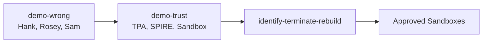

# AI Security Overwatch

**ACS AI Overwatch** is a security demonstration on OpenShift. Red Hat Advanced Cluster Security (ACS / RHACS) finds shadow AI agents, and an in-cluster rebuild replaces a caught agent with an approved Agent Sandbox.

Shadow Agentic IT is shadow IT applied to agents. Teams stand up unsanctioned chatbots and tool-using pods, often with an unapproved model, no telemetry, and extra capabilities such as scanners or a missing required label. This repository shows the loop from detection through replacement.

| Stage | What happens |
| --- | --- |
| Optional wrong phase | Helpful Hank, Rosey Regrets, and Sneaky Sam run as plain pods. ACS is in monitor mode, so the violations are recorded and the pods stay up. |
| Trust plane | Trusted Profile Analyzer, Zero Trust Workload Identity Manager (SPIFFE/SPIRE), and the Red Hat build of Agent Sandbox are installed before any rebuild. |
| Identify, terminate, rebuild | ACS switches to enforce, the shadow pods are removed, and the builder publishes a remediated image only after Trusted Profile Analyzer accepts the SBOM. |
| Approved agents | OpenClaw inside NVIDIA OpenShell, scheduled as an Agent Sandbox, with a SPIFFE JWT-SVID and Granite through Models-as-a-Service. Compliant Chris is the greenfield control. |

Read the guides in this order:

1. [Red Hat OpenShift](docs/redhat-openshift.md) — cluster version, storage, namespaces, and what must already be installed.
2. [Red Hat OpenShift AI setup for a clean build](docs/redhat-openshift-ai.md) — OpenShift AI 3.5, GPUs, and the DataScienceCluster on a cluster that has never run 2.25.
3. [Demo setup](docs/demo-setup.md) — the two install paths, agent images, Mattermost, ACS, and the trust plane.
4. [Argo CD GitOps setup and troubleshooting](docs/argocd-gitops.md) — Applications, cluster values, and the failures that stall a sync.
5. [PoC demo walkthrough (after setup)](docs/poc-demo-walkthrough.md) — run one agent script at a time and show what changed.



Path A (`oc apply -k gitops/argocd/`) installs the platform, the trust plane, and Compliant Chris, and skips Hank, Rosey, and Sam. Path B starts with `overlays/demo-wrong` and adds `overlays/demo-trust` after the violations are on screen. The steps are in [Demo setup](docs/demo-setup.md).

## Repository layout

```
acs-ai-overwatch/
├── README.md
├── docs/                              # the five guides linked above
├── agents/                            # Hank, Rosey, Sam, Chris, investigator, builder, console
├── gitops/argocd/                     # Applications and overlays
├── gitops/helm/                       # platform, misbehavior, trust-plane, approved, observability
├── pipelines/tekton/                  # legacy bulk build; BuildConfigs are the live path
└── scripts/
    ├── cluster-admin/                 # run before the first Argo CD sync
    └── demo/agents/                   # one execution script per agent
```

## Contributing

1. Put optional features behind `components.*` in `values.yaml`.
2. Keep the `test-range` isolation model and the existing namespace names.
3. When a cluster-specific hostname changes, regenerate `values-cluster.yaml` and update the discovery ConfigMap keys together. A stale apps domain breaks Routes. See [Argo CD GitOps setup and troubleshooting](docs/argocd-gitops.md).
4. Run `helm template` before opening a pull request. The commands are in the GitOps guide.
5. Do not commit kubeconfigs or live credentials. `QUAY_REGISTRY_PASSWORD` is written into `values-cluster.yaml` only when that environment variable is set. Leave it unset for a commit.

## License

Refer to your organization's licensing terms for Red Hat OpenShift, OpenShift AI, Advanced Cluster Security, and third-party components (UBI, llama.cpp, Mattermost, SeaweedFS, OpenShell, OpenClaw, and Hugging Face models).
